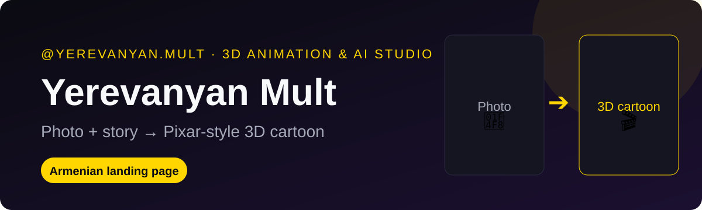
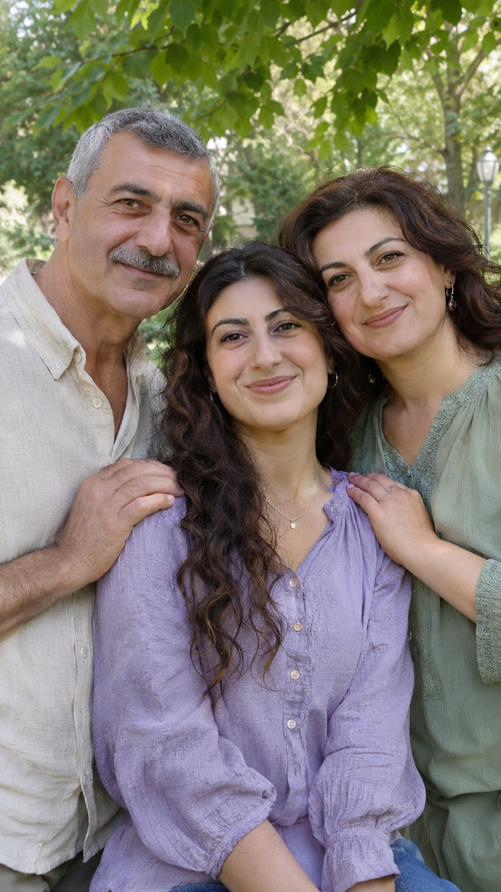
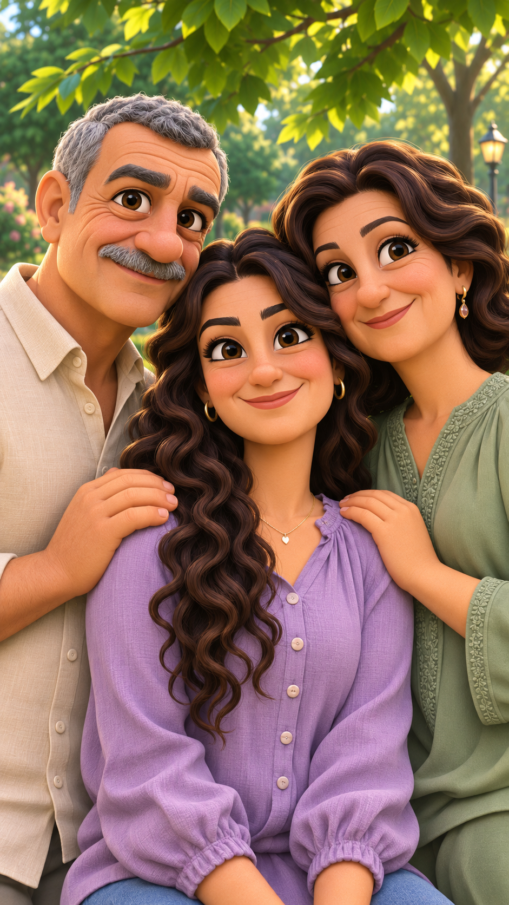

<p align="center">
  
</p>

<h1 align="center">Yerevanyan Mult</h1>

<p align="center">
  Armenian-language landing page for a small studio that turns photos and stories into Pixar-style 3D cartoon videos.
</p>

<p align="center">
  <a href="https://gev44.github.io/yerevanyan-mult/"></a>
</p>
<p align="center">
  
  
  
  
</p>

## What it is

**Yerevanyan Mult** (Երևանյան Մուլտ, Instagram [@yerevanyan.mult](https://www.instagram.com/yerevanyan.mult/)) makes personal 3D cartoons from a photo and a story. This repo is its one-page, mobile-first landing page, written in Armenian.

> «Քո Լուսանկարն ու Պատմությունը՝ 3D Մուլտֆիլմով»
> (*Your photo and your story, as a 3D cartoon*)

**For whom:** families and friends who want a cartoon gift, couples and parents planning an animated invitation, and local businesses that want a 3D ad Reel.
**Outcome:** a visitor sees a real before/after, builds a draft cartoon script in about 10 seconds, and sends it to the studio in one tap through an Instagram DM.

## Before / after

| Photo | 3D cartoon |
|:---:|:---:|
|  |  |

## What is on the page

- **Hero and before/after slider**: drag to compare a photo with its 3D cartoon version.
- **Script builder** (3 steps): pick the occasion (birthday, wedding, baby tale, talking 3D portrait with QR, business ad), the mood (funny, touching, epic) and a character trait. It generates a draft script and opens an Instagram DM with the text copied.
- **Four products**, each ordered by a DM keyword:
  1. Personal 3D cartoon from a photo, 15 to 60 s («ՄՈՒԼՏ»)
  2. 3D video invitation and Love Story («ՀՐԱՎԻՐԱՏՈՄՍ»)
  3. "Talking" 3D portrait with a QR code, plus a children's tale («ՀԵՔԻԱԹ»)
  4. 3D ad Reel for business («ԳՈՎԱԶԴ»)
- **Armenian AI business assistant demo**: a clickable sample chat (price, delivery, "I want an AI bot for my page").

## Tech

- One static `index.html` with inline CSS and vanilla JavaScript. No framework, no dependencies, no build step.
- System font stack including Noto Sans Armenian; dark theme with a gold accent.
- Contact deep link: `https://ig.me/m/yerevanyan.mult`.
- Deployed with GitHub Pages from `main`.

## Run locally

```bash
git clone https://github.com/GEV44/yerevanyan-mult.git
cd yerevanyan-mult
python -m http.server 8000   # then open http://localhost:8000
```

Opening `index.html` directly in a browser works too.

## Repo layout

```
index.html           the whole landing page
assets/              before_photo.jpg, after_cartoon.jpg (slider images)
docs/hero.svg        README banner
```

More AI video work: <https://gev44.github.io/ai-video.html>

## Contact

Built by **Gevorg Hovhannisyan**, ML/AI engineer in Yerevan. AI video, chatbots and automation:

- Telegram: [@hovhannisyan77](https://t.me/hovhannisyan77)
- WhatsApp: <https://wa.me/37444772541>
- Portfolio: <https://gev44.github.io>
- Studio Instagram: [@yerevanyan.mult](https://www.instagram.com/yerevanyan.mult/)
